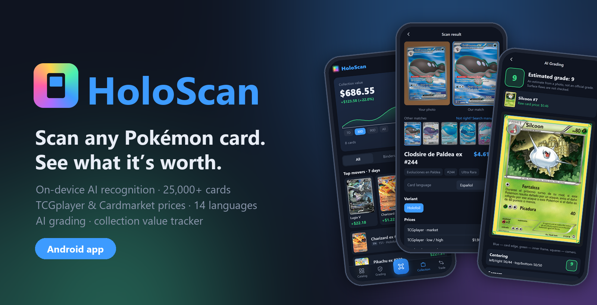
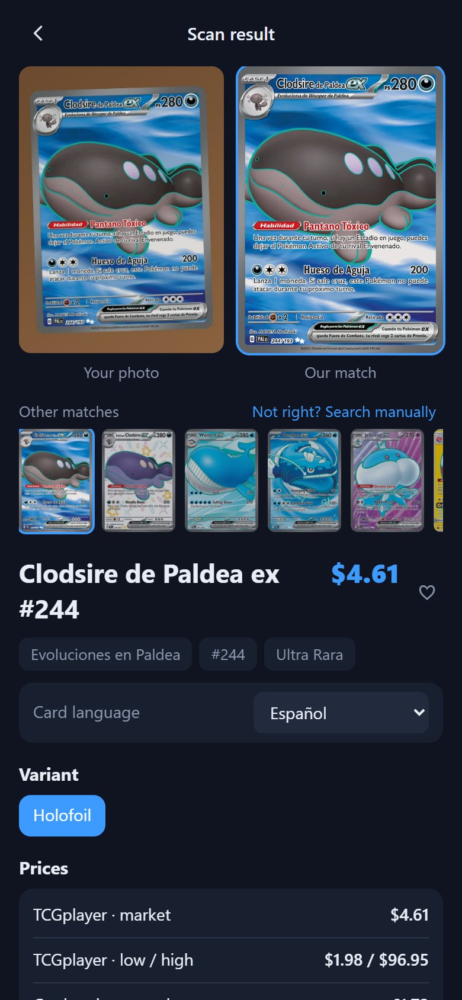
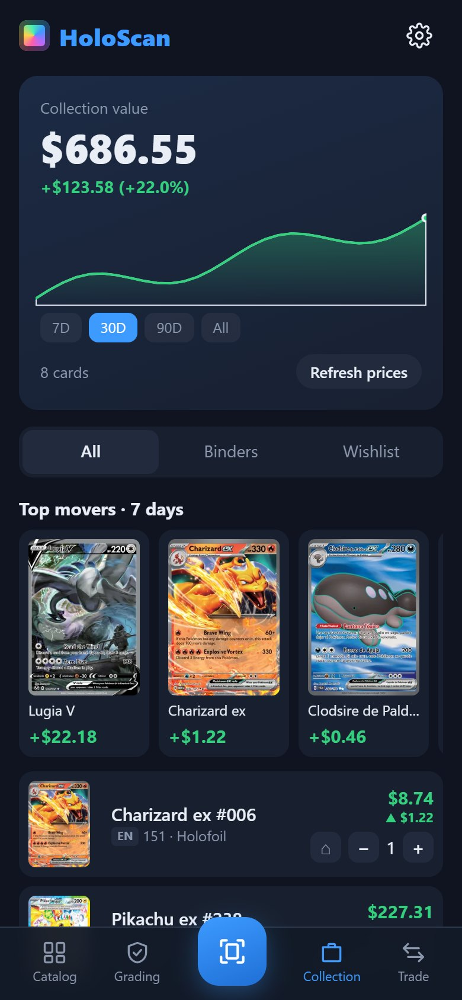
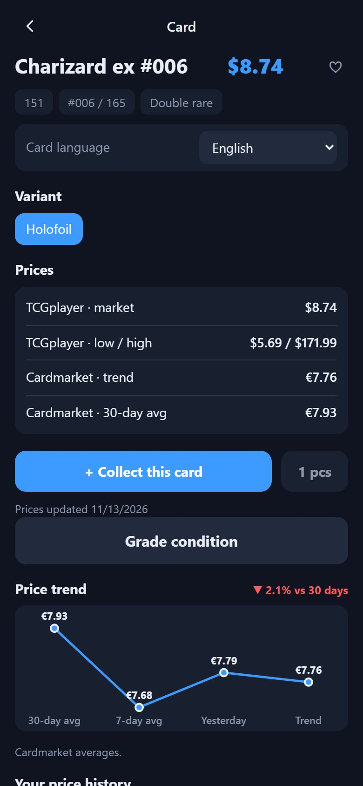
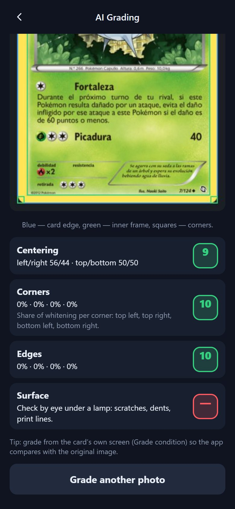
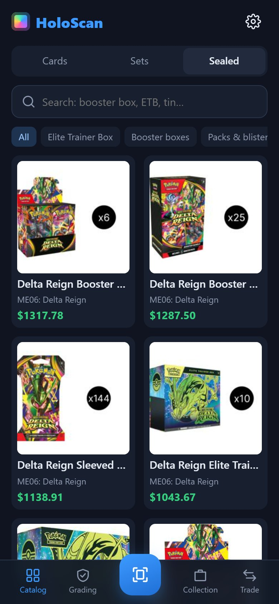
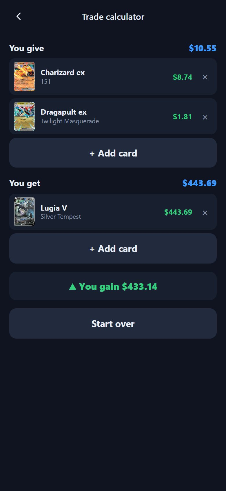

<p align="center">
  
</p>

<p align="center">
  
  
  
  
  
  
</p>

<p align="center">
  <b>Point your camera at a Pokémon card — HoloScan recognizes it in about two seconds<br>and shows its market price on TCGplayer and Cardmarket.</b>
</p>

<p align="center">
  <a href="#-features">Features</a> ·
  <a href="#-screenshots">Screenshots</a> ·
  <a href="#-how-recognition-works">How it works</a> ·
  <a href="#-build-from-source">Build</a> ·
  <a href="#-по-русски">По-русски</a>
</p>

---

## ✨ Features

**📷 Scan cards in seconds**
- On-device neural network (MobileNetV2) compares your photo with **25,000+ cards** — works offline, nothing is uploaded
- Reads the card name, number and HP to tell similar cards apart
- Handles glare, sleeves, toploaders and tilted photos
- **Batch mode** — lay cards in the frame one by one, each one is captured automatically
- Unsure match? It's marked **“Check”** with other likely cards to pick from

**💰 Prices**
- TCGplayer (USD) and Cardmarket (EUR) prices for every variant: normal, holo, reverse holo, 1st edition
- Price trend for each card (30-day, 7-day, yesterday)
- **3,500+ sealed products** — booster boxes, Elite Trainer Boxes, tins, blisters

**📈 Collection**
- Collection value chart (7 / 30 / 90 days) and **top movers** of the week
- **Sets** with completion progress and the cost to complete a set
- **Binders** to sort cards — for trade, for sale, favorites
- **Wishlist** with price-drop alerts, checked in the background
- **Trade calculator** — is the trade fair?
- Sign in with Google to sync the collection across devices

**🛡 AI grading**
- Estimates condition from a photo, the way grading companies check it: **centering** (e.g. 56/44), **corners** and **edges**
- Compares the photo with the original card image, so artwork isn't mistaken for wear
- Gives an estimated PSA-style grade — an estimate, not an official grade

**🌍 Languages**
- Cards in **14 languages**: English, Español, Français, Deutsch, Italiano, Português, 日本語, 한국어, 中文, ไทย, Bahasa Indonesia and more
- App in **7 languages**: English, Русский, Español, Français, Deutsch, Italiano, Português

## 📱 Screenshots

<table>
  <tr>
    <td align="center"><br><sub><b>Scan result</b> — your photo vs. the match</sub></td>
    <td align="center"><br><sub><b>Collection</b> — value chart and top movers</sub></td>
    <td align="center"><br><sub><b>Card</b> — prices and price trend</sub></td>
  </tr>
  <tr>
    <td align="center"><br><sub><b>AI grading</b> — estimated grade</sub></td>
    <td align="center"><br><sub><b>Grading details</b> — centering, corners, edges</sub></td>
    <td align="center"><br><sub><b>Sets</b> — completion and cost to finish</sub></td>
  </tr>
  <tr>
    <td align="center"><br><sub><b>Catalog</b> — search any card</sub></td>
    <td align="center"><br><sub><b>Sealed</b> — boxes, ETBs, packs</sub></td>
    <td align="center"><br><sub><b>Trade calculator</b></sub></td>
  </tr>
</table>

<sub>Screenshots use a demo collection: real cards and current prices, the value history is illustrative.</sub>

## 🧠 How recognition works

```
photo ─► find the card & straighten it
       ├─► neural network (MobileNetV2, ONNX Runtime) ─► compare with 25,600 card fingerprints
       └─► OCR (tesseract.js): name · number "039/198" · HP
                         ▼
          one score per candidate: image similarity + bonuses for matching text
                         ▼
          confident? ─► add to collection        unsure? ─► "Check" + other matches
```

Everything runs on the phone. On a test set of harsh photos (glare, toploader, perspective, JPEG noise) the right card comes first in **89%** of cases and is in the top 3 in **95%**; on clean photos — 29 of 30.

## 🔨 Build from source

Requirements: Node.js 18+, JDK 17, Android SDK 34.

```bash
npm install
npx cap sync android
cd android && ./gradlew assembleDebug
```

The APK appears in `android/app/build/outputs/apk/debug/`.

Google sign-in and sync need your own Firebase project: put its `google-services.json` into `android/app/` (it isn't in the repository).

Developer notes (in Russian): [docs/DEVELOPMENT.md](docs/DEVELOPMENT.md).

## 🧰 Tech stack

| | |
|---|---|
| App | Vanilla JS (ES modules, no bundler) wrapped with **Capacitor 6** |
| Recognition | **ONNX Runtime Web** + MobileNetV2 feature maps, **tesseract.js** OCR |
| Card data & prices | [TCGdex](https://tcgdex.dev) API, [tcgcsv.com](https://tcgcsv.com) (TCGplayer) for sealed products |
| Accounts & sync | Firebase Authentication + Firestore |
| Ads & alerts | AdMob (rewarded), Capacitor Local Notifications, Background Runner |

## ⚖️ Disclaimer

HoloScan is a fan-made tool and is not affiliated with, endorsed or sponsored by Nintendo, The Pokémon Company, Creatures, GAME FREAK, TCGplayer or Cardmarket. Pokémon and all card names and images are trademarks of their respective owners. Prices are market data from public sources and may differ from real sale prices. AI grading is an estimate, not an official grade.

---

## 🇷🇺 По-русски

**HoloScan** — Android-приложение для коллекционеров Pokémon TCG. Наводишь камеру на карту — приложение узнаёт её примерно за две секунды и показывает цену на TCGplayer и Cardmarket.

- **Распознавание на телефоне:** нейросеть сравнивает фото с базой из 25 000+ карт, работает без интернета. Справляется с бликами, протекторами и наклоном. Есть пакетный режим: кладёшь карты по одной, снимки делаются сами.
- **Цены:** TCGplayer и Cardmarket для каждого варианта, динамика цены, 3 500+ запечатанных товаров (бустер-боксы, ETB, тины).
- **Коллекция:** график стоимости, лидеры изменений за неделю, сеты с прогрессом сбора, папки, список желаний с оповещениями о снижении цены, калькулятор обмена, синхронизация через Google.
- **AI-оценка состояния:** центровка, углы и края по фото, примерная оценка по шкале PSA.
- **Языки:** карты на 14 языках, интерфейс на 7, включая русский.

Сборка описана выше, заметки для разработки — в [docs/DEVELOPMENT.md](docs/DEVELOPMENT.md).
